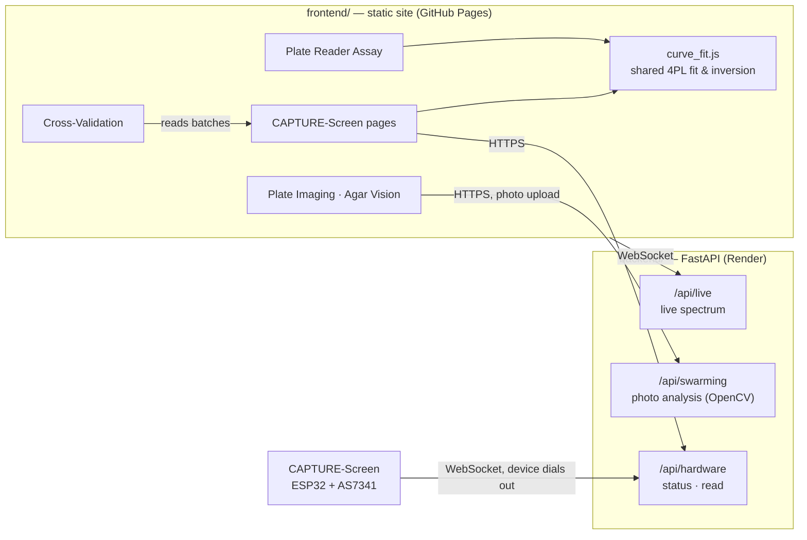

# LasReader

**Wet-lab data tools of iGEM NCKU-Tainan 2026 (Capture).** LasReader turns the fluorescence of an AHL biosensor into an inferred AHL concentration with a 95% confidence interval: on any plate reader, on CAPTURE-Screen (the team's own low-cost fluorescence reader), and across the two.

| | |
|---|---|
| **Team** | [NCKU-Tainan, iGEM 2026](https://2026.igem.wiki/ncku-tainan/) — wiki [Software](https://2026.igem.wiki/ncku-tainan/software) and [Hardware](https://2026.igem.wiki/ncku-tainan/hardware) pages |
| **Source code** | <https://gitlab.igem.org/2026/software/ncku-tainan/lasreader> |
| **Live app** | <https://igem-ncku-software.github.io/igem-software/> (a convenience copy; everything needed to run LasReader is in this repository) |
| **License** | [MIT](LICENSE) |

> **Research use only.** LasReader reports AHL concentrations *inferred* from a calibration curve. It is not intended for diagnostic use.

## What it does

A biosensor that reports AHL through a fluorescent protein gives a signal, not a concentration. Getting a concentration you can trust means subtracting backgrounds, combining replicates, fitting a standard curve and respecting its limits. LasReader does those steps in three browser tools, with nothing to install:

| Tool | For | Result |
|---|---|---|
| **Plate Reader Assay** | Any plate reader | AHL standards and samples from one plate are typed, pasted from Excel, or imported as the reader's 8 × 12 export. A weighted 4PL standard curve is fitted and each sample's AHL is inferred with a 95% CI, scaled by its dilution. Optional normalization to OD600. |
| **CAPTURE-Screen** | The team's reader (ESP32 + AS7341) | A live spectrum, then four pages used in order: check the instrument → calibrate tube by tube → review curves → measure samples in replicate. |
| **Cross-Validation** | Both | The same samples from both instruments, paired by name: a log-log plot, the geometric mean ratio and Bland–Altman 95% limits of agreement. |

Apart from AHL, a fourth tool measures a phenotype:

| Tool | For | Result |
|---|---|---|
| **Plate Imaging · Agar Vision** | Photos of plates (up to 24 per batch), swarming or another plate phenotype | The plate is found and its known diameter (93 mm by default) sets the scale; each colony's longest span, equivalent diameter and area are measured, and the photo is returned annotated. Runs on the backend (Python, OpenCV). |

Both instruments go through the same curve-fitting code, so the same readings give the same curve on either. Every value shown is a real reading: there is no simulated device or demo data.

**Who it is for:** wet-lab members of iGEM teams and other labs working with a fluorescent biosensor (no programming needed, and the Plate Reader Assay works with any plate reader); teams building a low-cost fluorescence reader, who can reuse CAPTURE-Screen's firmware and [data model](docs/capture_screen_model.md); and developers extending the tools.

## iGEM software requirements

| Requirement (Judge Handbook 2026) | Where it is met |
|---|---|
| Hosted on iGEM's GitLab | This repository |
| README: what, who, install and run, reproduce | [What it does](#what-it-does), [Installation](#installation), [Usage](#usage), [Reproducing the main results](#reproducing-the-main-results) |
| OSI-approved license | [LICENSE](LICENSE), MIT |
| Reproducible build and run | [`scripts/`](scripts/) (`setup` + `dev`, `.sh` and `.ps1`); no compiled binaries |
| Pinned dependencies | [`backend/requirements.txt`](backend/requirements.txt) pins every package, direct and transitive (tested on Python 3.14.3); Chart.js 4.4.1; firmware libraries under [Hardware](#hardware-capture-screen) |
| Repository under 50 MB | About 2 MB with its history (about 1 MB of files) |

## Installation

To *use* LasReader you only need a browser: open the [live app](https://igem-ncku-software.github.io/igem-software/). To run it locally you need Python 3.14 and Git (no Node.js; the frontend has no build step).

```bash
git clone https://gitlab.igem.org/2026/software/ncku-tainan/lasreader.git
cd lasreader
bash scripts/setup.sh    # once: creates backend/.venv and installs the pinned requirements
bash scripts/dev.sh      # backend on :8000, frontend on :5500; Ctrl+C stops both
```

On Windows PowerShell: `powershell -ExecutionPolicy Bypass -File scripts\setup.ps1`, then `scripts\dev.ps1`.

Open <http://127.0.0.1:5500>. The backend's interactive API documentation is at <http://127.0.0.1:8000/docs>.

<details>
<summary>Without the scripts</summary>

```bash
cd backend
python -m venv .venv
.venv\Scripts\activate          # macOS/Linux: source .venv/bin/activate
pip install -r requirements.txt
uvicorn app.main:app --reload   # must be app.main:app, run from backend/

# in another terminal
cd frontend
python -m http.server 5500
```

Pages served from `localhost` use the local backend; anywhere else they use the Render backend ([`frontend/js/config.js`](frontend/js/config.js)). Serve the pages over HTTP rather than opening them as `file://`, or the live spectrum can't connect. Backend settings (allowed origins, device timeouts) are in [`backend/.env.example`](backend/.env.example).
</details>

## Usage

### Plate Reader Assay

Read the AHL standards (0 nM blanks included) and the samples on the same plate.

1. **Enter data** — date, strain and detection; one row per standard concentration or sample (with its dilution), 1–6 replicates. Enter by *Pasting a plate (8 × 12)* (the default: paste the reader's export and mark the wells on a plate map) or *Typing the table* (type, or paste from Excel). *Fluorescence ÷ OD600* adds an OD600 value per replicate and a medium blank.
2. **Fit** — exclude a reading only with a reason, then fit (at least 4 concentrations and 2 blanks).
3. **Results** — each sample's AHL in the well and in the sample, with a 95% CI; outside the usable range only the bound is shown.
4. **Export** — CSV of every reading and result, and the curve as PNG. Nothing is stored.

### CAPTURE-Screen

A step bar on every page shows which step comes next; a step that can't start yet says what it is waiting for.

1. **Instrument** — connection status and a self-check with a buffer-only cuvette.
2. **Calibrate** — enter the strain and standards, read each tube in the order shown (or type in recorded readings), fit the 4PL, save the curve.
3. **Curves** — each saved curve, its LOD and usable range, and whether it matches the instrument now.
4. **Measure** — choose a curve, read blanks, then samples in replicate; each sample gets an inferred AHL with a 95% CI. Export as CSV.

Runs, curves and batches are kept in the browser; the **Data** page backs them up to one JSON file and restores them.

### Cross-Validation

Load a Plate Reader Assay CSV and a CAPTURE-Screen batch (from this browser or its CSV), with the same sample names on both. Export the comparison as CSV and PNG.

### Plate Imaging · Agar Vision

Enter the assay type (Swarming by default) and the date, choose the plate photos (taken from above), give each its strain, condition and replicate, check the plate diameter, and press Analyse; the photos are analysed one after another. View each photo to check that the green circle matches the plate edge, then export the CSV (every photo's colonies in one file) and the annotated photos.

## Reproducing the main results

The repository ships no example dataset, because LasReader uses real readings only; every result is reproduced from its exported file.

- **Plate Reader Assay:** the CSV holds every reading with its well and exclusion reason. Enter the readings again, apply the same exclusions and fit; the curve and inferred AHL are recomputed by [`js/curve_fit.js`](frontend/js/curve_fit.js).
- **CAPTURE-Screen curve:** with the instrument, follow Usage steps 1–4. Without it, open Calibrate → *Enter recorded data*, type in the recorded standards and blanks with the configuration they were read under, and fit. A curve can also be restored from the Data page's backup.
- **Cross-Validation:** load the same two CSVs and the same dilution.
- **Plate Imaging · Agar Vision:** upload the same photos with the same plate diameter; the CSV records the photo name and diameter on every row. The analysis is deterministic, so the numbers come out the same. A photo wider than 1200 px is shrunk to 1200 px wide before analysis (the notebook's pixel thresholds were set on photos of about that size), and the CSV records both sizes.

## How it works



- **AHL analysis runs in the browser**, in plain JavaScript modules, so the Plate Reader Assay and Cross-Validation work without the backend. Plate Imaging · Agar Vision is the exception: its image analysis is the team's Python/OpenCV code, run on the backend, which stores neither the photo nor the result.
- **For CAPTURE-Screen, the backend only relays the device.** CAPTURE-Screen dials out to the backend (so it works behind any lab router) and pages talk to the backend. Each measurement is dark → light → dark, about 3 s.
- **Statistics.** A 4-parameter logistic curve fitted by weighted Levenberg–Marquardt; LOD and LOQ from the blanks; inversion with a delta-method 95% CI. No concentration is shown outside a curve's usable range: the software never extrapolates. A CAPTURE-Screen curve only converts readings taken with the same strain and instrument configuration. Cross-Validation compares on the log scale (geometric mean ratio, Bland–Altman limits of agreement).

Every equation and the reasoning behind it are in **[docs/capture_screen_model.md](docs/capture_screen_model.md)**.

### Standards and interfaces

- **Standards it builds on:** the 96-well plate layout (wells A1–H12) for plate import; RFC 4180 CSV (UTF-8) for every export, which Cross-Validation reads back; any signal unit, so readings already calibrated to a fluorescein standard (the iGEM InterLab's MEFL) go in unchanged; the four-parameter logistic, LOD/LOQ at 3 and 10 blank SDs, and Bland–Altman limits of agreement. SBOL is not used: LasReader handles measurements, not genetic designs.
- **Fitting module:** [`js/curve_fit.js`](frontend/js/curve_fit.js) is pure functions with no dependencies. `CurveFit.fit(points)` returns the curve, LOD, LOQ and usable range; `CurveFit.invert(signal, fit, n)` returns a concentration with its 95% CI, or says it is out of range. The wiki's "Try it with your data" panel loads it unchanged.
- **HTTP API:** `/api/hardware` (device status and reads), `/api/live/spectrum` (WebSocket), `/api/swarming/analyze` (photo analysis). The HTTP routes are described as OpenAPI at `/docs`.
- **Device protocol:** JSON over WebSocket, checked against [`backend/app/hardware/models.py`](backend/app/hardware/models.py).
- **Files:** the Plate Reader Assay CSV has 40 named columns, with the curve and each sample's result beside every reading; CAPTURE-Screen batches export as CSV and back up as JSON; Plate Imaging · Agar Vision exports CSV and annotated photos.

### Repository layout

```
frontend/   static site: one HTML page and one script per page (CAPTURE-Screen has five), shared js/curve_fit.js
backend/    FastAPI: app/hardware (device relay), app/live (live spectrum), app/swarming (photo analysis), tests/
firmware/   CAPTURE-Screen firmware: one Arduino sketch per build
docs/       CAPTURE-Screen data model
scripts/    setup and run scripts (.sh and .ps1)
```

## Hardware: CAPTURE-Screen

CAPTURE-Screen has two builds, each with its own sketch. Both speak the same protocol, so every page works with either; one is connected at a time, and each has its own build ID, so a curve made on one never converts the other's readings.

| Build | Sketch | Has |
|---|---|---|
| Laser-cut | `firmware/capture_screen/` | OLED status display, Live button on GPIO 13 |
| 3D-printed | `firmware/capture_screen_3d/` | No display or button: Live is switched from the website. LED gate on GPIO26 |

1. In the Arduino IDE, install ESP32 board support (core 3.3.8) and the libraries DFRobot_AS7341 1.0.0, ArduinoJson 7.4.3 and WebSockets 2.7.2 (Markus Sattler); the laser-cut build also needs Adafruit SSD1306 2.5.17, Adafruit GFX 1.12.6 and Adafruit BusIO 1.17.4.
2. In the build's folder, copy `secrets.h.example` to `secrets.h` and enter your 2.4 GHz Wi-Fi name and password (`secrets.h` is never committed).
3. Flash the build's `.ino` to an ESP32 Dev Module.

When the device is online, the landing page names the build and shows its live spectrum (the laser-cut build's OLED also shows `Web ok`). If not, the Serial Monitor (115200) shows `[wifi]` and `[backend]` lines. To use a local backend instead, set `BACKEND_HOST`, `BACKEND_PORT` and `BACKEND_USE_TLS` in `secrets.h`.

**3D-printed build: measure its LED current first.** Its sketch ships with `LED_CURRENT_MA` set to our build's measured value (12.488 mA); on another build, measure your own and replace it. A value of 0 means "not measured" and makes the sketch refuse every read until it is set (Live still works). Switch Live on so the LED stays lit, measure the DC voltage across R1 with a multimeter, divide by R1's resistance (217 Ω measured), enter the result in mA to three decimals, and flash again. The value feeds the config fingerprint every calibration curve is bound to, so make no curves before it is set. This build kept its radio off under its earlier serial firmware, because a Wi-Fi transmit burst can pull on the supply the LED shares; the sketch sends nothing during a read, and the self-check's dark stability and repeated reads of one cuvette are how to confirm on the bench that Wi-Fi doesn't show in the readings.

## Testing

```bash
cd backend
pytest        # 46 tests: device relay, live spectrum, swarming upload
```

Each build's firmware compiles with `arduino-cli compile --fqbn esp32:esp32:esp32doit-devkit-v1 firmware/capture_screen` (or `firmware/capture_screen_3d`).

## Known limitations

- **Few real runs so far.** The Plate Reader Assay has fitted one calibration from the team's wet lab, a SpectraMax M3 plate (Figure 2 on the wiki's [Software](https://2026.igem.wiki/ncku-tainan/software#results) page), and CAPTURE-Screen has run calibrations at the bench (Figures 8a–8b there). Neither gives a validated AHL concentration, because the biosensor's response to AHL is not yet established. The Plate Reader Assay's OD normalization (subtracting a medium blank) is not yet confirmed against the wet lab's protocol, Cross-Validation has no real dataset yet, and the fit has not been compared with an established fitting tool on the same readings.
- **Plate Imaging · Agar Vision needs a clean photo.** The scale assumes the plate was photographed square-on, and a bright, even reflection can be read as a colony; photograph from above, lid off, away from overhead light, and View each result. Its filters were set on swarming plates.
- **No automated tests for the curve fit.** The 46 tests cover the backend; `js/curve_fit.js` runs in the browser and is checked by hand.
- **Placeholder signal.** CAPTURE-Screen uses the F4 channel alone until an sfGFP standard's spectrum is measured ([model §3.3](docs/capture_screen_model.md#33-unmixing-choosing-the-signal)).
- **No thresholds without data.** No replicate CV limit and no pass/fail for cross-validation agreement until real data shows what to expect.
- **Browser-only storage** for CAPTURE-Screen; back up from the Data page.
- **No authentication** on the device link yet.

## For future teams

Fork it freely. To add a plate reader format, convert it into the Plate Reader Assay's table, as [`js/plate_layout.js`](frontend/js/plate_layout.js) does for a pasted plate. A backend feature is a folder under `backend/app/` with its own `router.py`, mounted in `main.py`. When a formula changes, update [docs/capture_screen_model.md](docs/capture_screen_model.md) with it.

## Authors and acknowledgment

LasReader is part of **iGEM NCKU-Tainan 2026** (National Cheng Kung University, Tainan, Taiwan).

- **Software:** Yu-Chun Sung designed and wrote the software in this repository: the web app, the backend and the CAPTURE-Screen firmware, apart from the analysis below.
- **Colony image analysis:** Tzu-Chiao Chou wrote the colony-measurement code (`iGEM_cv.ipynb`) that [`backend/app/swarming/analysis.py`](backend/app/swarming/analysis.py) runs; Yu-Chun Sung integrated it into LasReader.
- **Hardware:** the CAPTURE-Screen device was developed by other team members; see the wiki's [Hardware](https://2026.igem.wiki/ncku-tainan/hardware) page.

All team members and their contributions are listed on the wiki's [Team](https://2026.igem.wiki/ncku-tainan/team) and [Attributions](https://2026.igem.wiki/ncku-tainan/attributions) pages. We thank the authors of the open-source libraries LasReader uses.

## License

[MIT](LICENSE). Third-party libraries (Chart.js, the Python and Arduino packages) keep their own licenses and are installed or loaded from their sources, not redistributed here.
